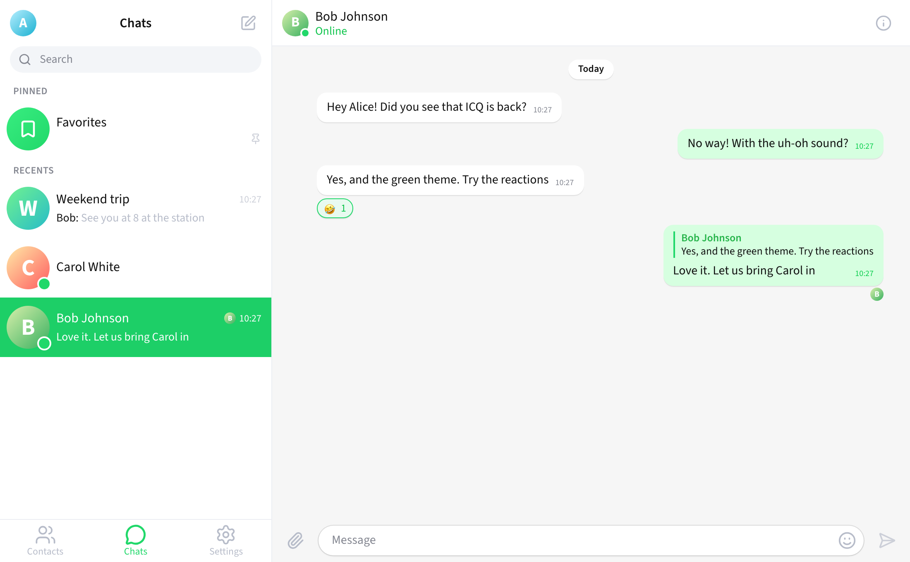
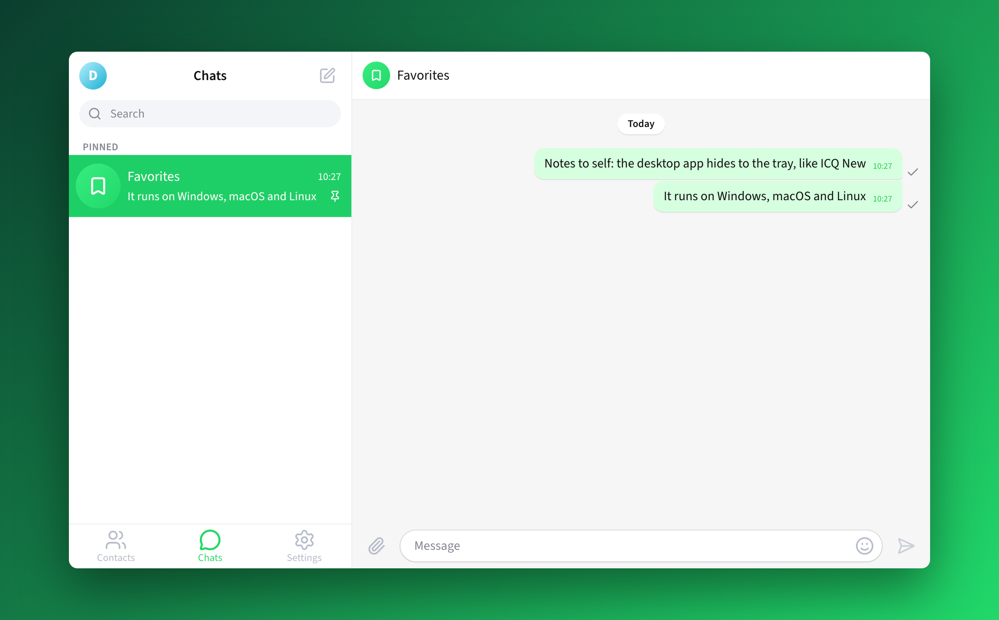

<div dir="rtl">

# openICQ

ה-ICQ האחרון, ICQ New (2020 עד 2024), בנוי מחדש מאפס ובקוד פתוח. אפליקציה ל-Windows, macOS ו-Linux, ואפליקציית ווב לכל דפדפן, עם שרת משלכם.

[הורדה](https://github.com/saharhazan/openICQ/releases/latest) · [English](README.md)



ICQ נסגר ב-26 ביוני 2024. הגרסה האחרונה שלו, ICQ New 23.2.0, הייתה מסנג'ר מודרני: רשימת שיחות לצד השיחה, בועות ירוקות, קבוצות, ריאקציות וה-"uh-oh" המפורסם.

openICQ מחזיר אותו, והפעם הוא שלכם. אתם מריצים את השרת, על המחשב, בבית או ב-VPS, וכל מי שתזמינו מקבל מספר ICQ משלו. זה לא דמו: שרת אמיתי שומר חשבונות, שיחות, קבוצות, קבצים והיסטוריה, והכל בזמן אמת.

## מה יש

- **מספר ICQ משלך:** נרשמים עם שם וסיסמה ומקבלים מספר רץ מ-100000. נכנסים עם המספר או עם אימייל.
- **רשימת שיחות:**
  - Favorites נעוץ למעלה.
  - נעיצה, מונים של הודעות שלא נקראו, השתקה, "Mark as unread", טיוטות ו-"is typing...".
  - חיפוש באנשי קשר, בשיחות ובאנשים בשרת.
- **הודעות:**
  - בועות במידות המקוריות, גלולות תאריך ו-"New messages".
  - וי של "נמסר" ואווטארים של מי שקרא.
  - תשובה, העברה, עריכה ("edited"), ומחיקה לי או לכולם.
  - שש הריאקציות של ICQ New, בורר אימוג'י ובחירה מרובה.
- **קבצים ותמונות:** צירוף, גרירה לחלון, הדבקה, תצוגה מקדימה וצופה תמונות.
- **קבוצות:**
  - תפקידים: Creator, Admin ו-Read only.
  - קישורי הזמנה, הצטרפות באישור, והודעות השירות המקוריות.
- **אנשי קשר ופרופיל:**
  - הוספה לפי כינוי או מספר ICQ.
  - אווטאר, שם, "About me" וכינוי שנבדק בזמן ההקלדה.
  - חסימה.
- **הגדרות:**
  - General ו-Notifications.
  - Privacy, כולל "Who can add me to groups" ו-Session List.
  - Appearance: ערכות Green ו-Dark Green, גודל גופן ותצוגה קומפקטית.
  - Shortcuts.
- **כמה מכשירים במקביל:** אפשר לסגור כל session מרשימת המכשירים.
- **אפליקציית מחשב:**
  - חלון ראשי אחד בגודל 1000x600, כמו ב-ICQ New.
  - סגירה מסתירה למגש.
  - באדג' של הודעות שלא נקראו והתראות מערכת.
  - הפעלה עם המחשב.
  - שרת מובנה.



## התקנה

מורידים את הקובץ המתאים מ-[הגרסה האחרונה](https://github.com/saharhazan/openICQ/releases/latest):

| מערכת | קובץ |
|---|---|
| Windows 10 ו-11 | קובץ ההתקנה `.exe` |
| Mac עם מעבד Apple | `openICQ-<version>-mac-arm64.dmg` |
| Mac עם מעבד Intel | `openICQ-<version>-mac-x64.dmg` |
| Linux | `.AppImage` לכל הפצה, או `.deb` ל-Debian ו-Ubuntu |

הקבצים לא חתומים בתעודה בתשלום, ולכן כל מערכת שואלת פעם אחת לפני ההפעלה הראשונה:

- **Mac:**
  1. גוררים את openICQ ל-Applications.
  2. לוחצים עליו בכפתור הימני ובוחרים **Open**, ואז שוב **Open**.
  3. אם מופיעה הודעה שהאפליקציה "פגומה", מריצים פעם אחת: `xattr -dr com.apple.quarantine /Applications/openICQ.app`.
- **Windows:** אם מופיע "Windows protected your PC", לוחצים **More info** ואז **Run anyway**.
- **Linux:**
  - מריצים `chmod +x openICQ-*.AppImage` ואז את הקובץ, או `sudo apt install ./openICQ-*.deb`.
  - ב-Ubuntu 24.04 ומעלה, אם ה-AppImage נסגר מיד, מתקינים את ה-`.deb`.

### הפעלה ראשונה

openICQ שואל איך להתחבר:

- **Host a server on this computer:** התוכנה מריצה את השרת בעצמה, והשיחות נשמרות במחשב שלכם. מסמנים **Let other computers on my network connect**, והחלון מציג את הכתובת שחברים ברשת צריכים להקליד.
- **Connect to a server:** מקלידים כתובת של שרת openICQ, למשל מחשב של חבר (`192.168.1.20:5190`) או שרת באינטרנט (`chat.example.com`, דרך HTTPS).

אחר כך נרשמים, מוסיפים חברים לפי כינוי או מספר ICQ, ומדברים.

## שרת קבוע

```sh
docker compose -f docker/compose.yaml up -d
```

ואז פותחים את `http://localhost:5190`. לפני שחושפים את השרת לאינטרנט:

1. רושמים את כל הכתובות ב-`ALLOWED_ORIGINS`.
2. מפעילים HTTPS ומגדירים `COOKIE_SECURE=true`.
3. בודקים את מגבלות האחסון:
   - `MAX_FILE_BYTES`: לקובץ, ברירת מחדל 100MB.
   - `MAX_USER_STORAGE_BYTES`: למשתמש, ברירת מחדל 2GB.
   - `MAX_TOTAL_STORAGE_BYTES`: לכל השרת, ללא הגבלה כברירת מחדל.

## פיתוח

```sh
pnpm install
pnpm dev            # שרת ולקוח ווב עם טעינה חמה
pnpm dev:desktop    # אפליקציית המחשב
pnpm dist:desktop   # קבצי התקנה למערכת הנוכחית
```

הבדיקות רצות ב-GitHub Actions בכל push:
- בדיקות unit ואינטגרציה.
- בדיקות מקצה לקצה בדפדפן.
- בדיקות מקצה לקצה של אפליקציית המחשב על Windows, macOS ו-Linux.

תג `v*` בונה את קבצי ההתקנה ומפרסם גרסה.

## כמה זה נאמן למקור

העיצוב וההתנהגות לקוחים מהמקור. אלה המקורות:
- הקוד הפתוח הרשמי של לקוח ICQ למחשב ([mail-ru-im/im-desktop](https://github.com/mail-ru-im/im-desktop), Apache 2.0).
- קבצי ההתקנה של הגרסה האחרונה 23.2.0. פירקנו אותם עם [REA](https://github.com/morluto/rea) בלי להריץ אותם.
- דפי העזרה שנשמרו בארכיון.

מהם הגיעו הצבעים המדויקים, המידות, הפריסה, התפריטים בסדר המקורי, הטקסטים, הצלילים וההתנהגות. הכל מתועד ב-[`docs/research`](docs/research). גרסת ה-2001b הקודמת שמורה ב-tag `classic-2001b`.

ההבדלים, בכוונה:
- כניסה עם מספר ICQ או אימייל וסיסמה, בלי טלפון ובלי SMS.
- שיחות קול ווידאו מתוכננות לגרסה הבאה.
- ערוצים, הודעות קוליות, תצוגה מקדימה לקישורים ואזכורים לא נכללים בגרסה הזו.
- האייקונים מ-[Lucide](https://lucide.dev), והאימוג'י של מערכת ההפעלה.
- האייקונים, הסטיקרים, האימוג'י, הגופנים והצלילים המקוריים לא בשימוש. הצלילים מסונתזים.
- אייקון האפליקציה הוא פרח שלנו.

## אבטחה

- **סיסמאות:** מוצפנות עם scrypt.
- **sessions:** tokens אקראיים ב-cookie מסוג HttpOnly.
- **בדיקות:** כל בקשה עוברת אימות, וכל פעולה נבדקת מול החברות והתפקיד של המשתמש.
- **קבצים:**
  - תמונות מזוהות לפי התוכן.
  - יש מגבלות אחסון.
  - קבצים שלא צורפו נמחקים.
- **מגבלות קצב:** על הודעות, עריכות, ריאקציות, העלאות, כניסות והרשמה.
- **אפליקציית המחשב:** רצה ב-sandbox, נשארת על השרת שלכם, ומאמתת כל הודעה בין התהליכים.

## משפטי

openICQ הוא פרויקט מעריצים עצמאי. הוא לא קשור ל-ICQ, ל-AOL, ל-Mail.ru או ל-VK, ולא אושר על ידן. "ICQ" והלוגו שלו הם סימנים מסחריים של בעליהם.

הקוד מופץ תחת [רישיון MIT](LICENSE), ופירוט הרכיבים של צד שלישי נמצא ב-[THIRD_PARTY](docs/licenses/THIRD_PARTY.md).

</div>
