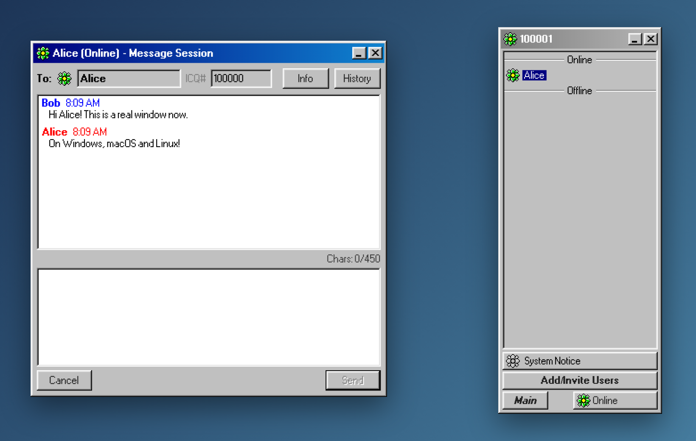
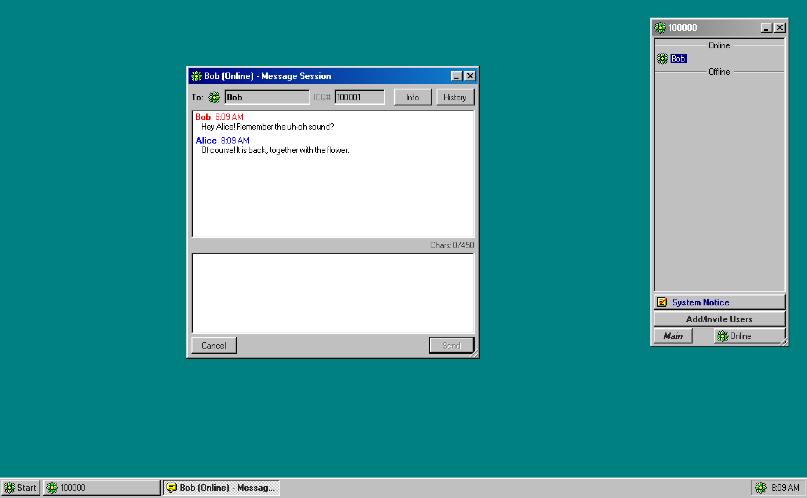
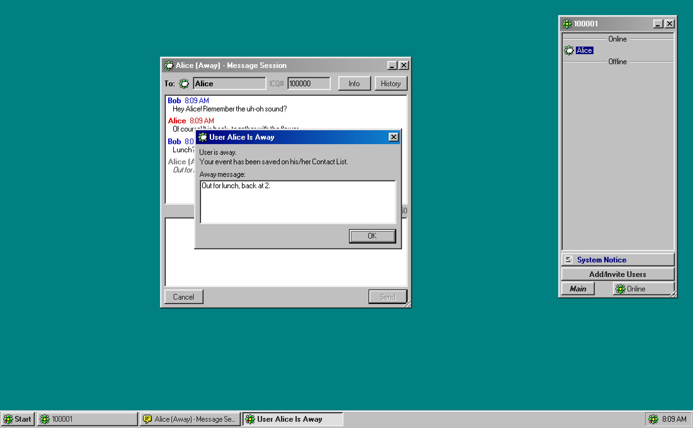
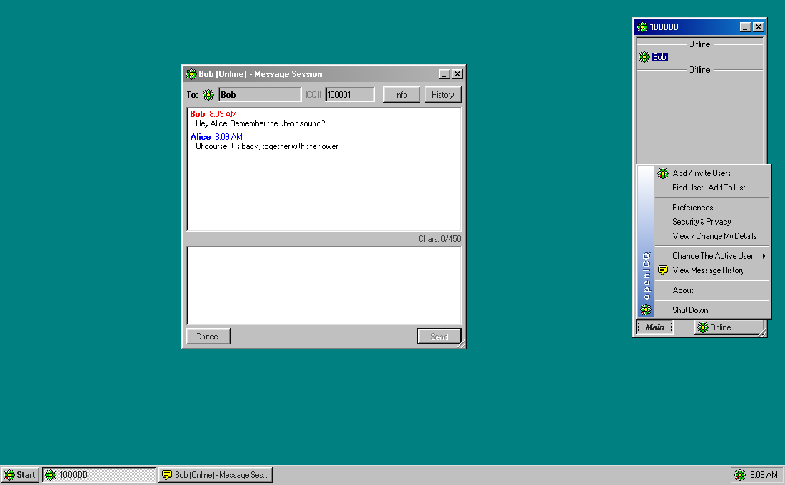
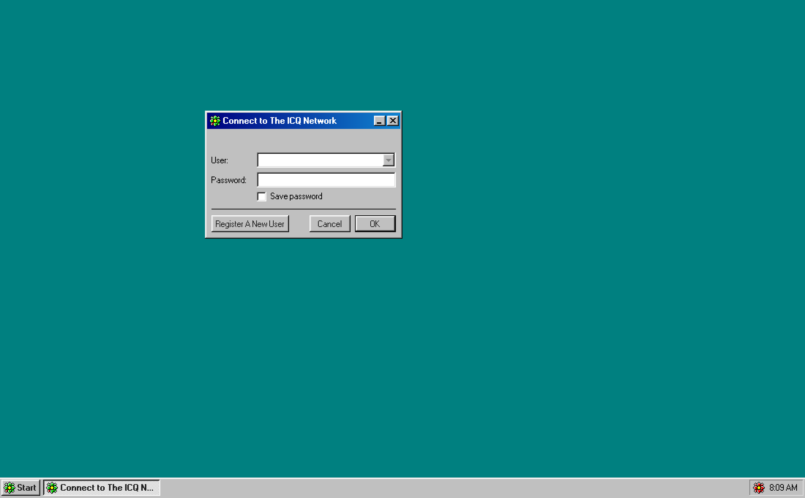
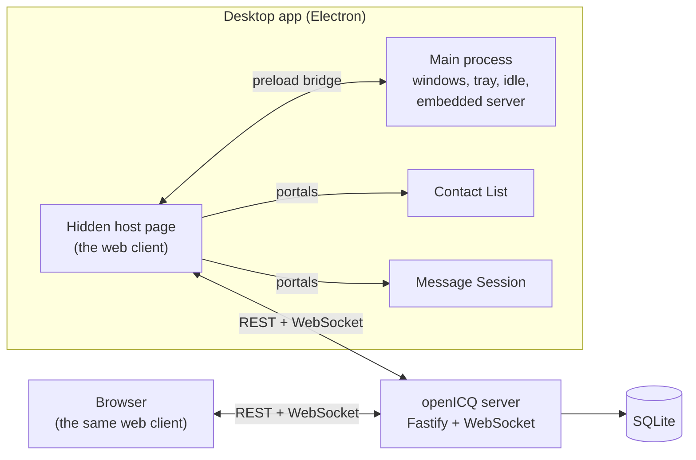

<p align="center">
  
</p>

<h1 align="center">openICQ</h1>

<p align="center">
  The classic ICQ 2001b messenger, rebuilt from scratch and open source.<br />
  Native on Windows, macOS and Linux, and it also runs in any browser.
</p>

<p align="center">
  <a href="https://github.com/saharhazan/openICQ/releases/latest"><strong>Download</strong></a> ·
  <a href="#install">Install</a> ·
  <a href="#run-a-server">Run a server</a> ·
  <a href="#develop">Develop</a> ·
  <a href="README.he.md">עברית</a>
</p>

<p align="center">
  <a href="https://github.com/saharhazan/openICQ/actions/workflows/ci.yml"></a>
  <a href="https://github.com/saharhazan/openICQ/releases/latest"></a>
  <a href="LICENSE"></a>
</p>



openICQ brings back the look, the sounds and the habits of ICQ 2001b: the tall Contact List with its flower, the status menu, Away messages with auto-responses, "Uh-oh!" on every new message, System Notices for authorization, and your own ICQ# (UIN). It is not a mockup. A real server stores accounts, contacts, offline messages and history, and every client talks to it in real time.

## Features

- **Your own ICQ#**: sequential numbers from 100000, registration wizard, "Save password".
- **Contact List**: Online, Offline and Not In List groups, renaming, deleting, the blinking message balloon.
- **All eight statuses**: Online, Free For Chat, Away, N/A, Occupied, DND, Invisible, Offline, with the original menu captions.
- **Away messages**: set per status with the countdown dialog, and shown to the sender as an auto-response.
- **Occupied and DND**: the original "Send Urgent / Send To Contact List" choice.
- **Authorization**: requests, grants and refusals as System Notices; "My authorization is required" per account.
- **Messages**: real-time delivery, offline messages delivered on the next sign-in, the 450 character limit, history with paging, clickable links.
- **Find users** by ICQ#, email or details; user info; ignore list; password change; Web Aware.
- **Auto-away** after 10 minutes and N/A after another 20. The desktop app watches the whole computer, the browser watches the page.
- **One sign-in at a time**: signing in elsewhere shows "Your ICQ# is being used on another computer".
- **Desktop app**: every ICQ window is a native window (frameless, Win98 style, on every OS). openICQ lives in the system tray or menu bar with the status flower, shows an unread badge and flashes or bounces on new messages.

| In the browser | |
|---|---|
|  |  |
|  |  |

## Install

Download the file for your system from the [latest release](https://github.com/saharhazan/openICQ/releases/latest):

| System | File |
|---|---|
| Windows 10 and 11 | the `.exe` setup |
| macOS, Apple Silicon | `openICQ-<version>-mac-arm64.dmg` |
| macOS, Intel | `openICQ-<version>-mac-x64.dmg` |
| Linux | the `.AppImage` (any distribution) or the `.deb` (Debian, Ubuntu); x64 and arm64 |

The builds are not signed with a paid certificate, so each system asks once before the first start:

- **macOS**: open the dmg and drag openICQ to Applications. Right-click openICQ, choose **Open**, then **Open** again. If macOS reports that the app "is damaged", run `xattr -dr com.apple.quarantine /Applications/openICQ.app` once.
- **Windows**: SmartScreen may say "Windows protected your PC". Click **More info**, then **Run anyway**.
- **Linux**: `chmod +x openICQ-*.AppImage && ./openICQ-*.AppImage`, or `sudo apt install ./openICQ-*.deb`. If the AppImage closes right away on Ubuntu 24.04 or later, install the `.deb` instead. Ubuntu restricts the sandbox that AppImages use. For the tray icon on GNOME, install the "AppIndicator and KStatusNotifierItem Support" extension.

`SHA256SUMS.txt` in every release lists the checksum of each file.

### First start

openICQ asks how to reach the ICQ network:

- **Host a server on this computer**: the app runs the openICQ server itself. Tick **Let other computers on my network connect** and the dialog shows the address your friends type in.
- **Connect to a server**: enter the address of an openICQ server, for example a friend's computer (`192.168.1.20:5190`) or a server on the internet (`chat.example.com`).

You can change this later from the tray menu, under **Connection Settings...**. Then register a new ICQ#, add your friends by their ICQ# and start chatting.

## Run a server

For a server that is always on (a home server, a NAS, a VPS):

```sh
docker compose -f docker/compose.yaml up -d
```

Then open `http://localhost:5190`, or point the desktop app at this machine. The database lives in the `openicq-data` volume. Before you put the server on the internet:

- List every address people use in `ALLOWED_ORIGINS` (for example `https://chat.example.com`).
- Serve it over HTTPS, for example behind Caddy or nginx, and set `COOKIE_SECURE=true`.

Without Docker, with Node.js 26 and pnpm 10:

```sh
pnpm install
pnpm build
pnpm start        # http://127.0.0.1:5190
```

All settings come from environment variables; see [`apps/server/.env.example`](apps/server/.env.example).

## Develop

```sh
pnpm install
pnpm dev            # server on :5190 and the web client with hot reload on http://127.0.0.1:5173
pnpm dev:desktop    # builds and starts the desktop app
pnpm dist:desktop   # installers for the current OS into apps/desktop/release
```

| Check | Command |
|---|---|
| Lint and types | `pnpm lint`, `pnpm typecheck` |
| Unit and integration tests (241) | `pnpm test` |
| Web end-to-end, two users in Chromium (10) | `pnpm test:e2e` |
| Desktop end-to-end, two Electron apps (7) | `pnpm test:desktop` |
| README screenshots | `pnpm --filter @openicq/e2e screenshots` |

GitHub Actions runs all of them, with the desktop tests on Windows, macOS and Linux. Pushing a `v*` tag builds the installers on each OS and publishes a release.

### Architecture



| Package | What it is |
|---|---|
| `packages/protocol` | The wire contract: zod schemas for every request, result and event, shared by client and server. |
| `apps/server` | Fastify 5 with WebSockets and SQLite (`node:sqlite`). Layers: domain, application, infrastructure, transport. |
| `apps/client` | React 19 + zustand + 98.css. One store and one connection. It renders every window into the page, or into native windows in the desktop app. |
| `packages/desktop-bridge` | The contract between the desktop shell and the client, validated on both sides. |
| `apps/desktop` | Electron 44. A hidden host page opens each ICQ window natively. Tray, system idle time, and the server embedded for "Host a server". |
| `tests/e2e` | Playwright: two users in the browser, two desktop apps, and the screenshot generator. |

TypeScript runs natively in Node 26 (type stripping). The desktop app is bundled with esbuild.

## How faithful is it?

The look and the texts come from the original. The ICQ 2001b installer (build 3659, from the Internet Archive) was taken apart with [REA](https://github.com/morluto/rea) without running it. That gave the window layouts, sizes, menu captions, every message text and the sound mapping. The findings are in [`docs/research`](docs/research).

What differs, on purpose:

- **Artwork and sounds**: icons are redrawn and sounds are synthesized, because the originals are copyrighted. No original artwork, sound or binary is part of this repository.
- **History** is kept on the server, so it follows you to any computer (the original kept it on the PC).
- **Left out**: features that need services that no longer exist (ICQ Services, the banner, chat rooms, file transfer, SMS).
- **Unknown details**: where the installer did not reveal something (the exact menu order, some timings), the choice follows the original's logic and is marked in the research notes.

## Security

- Passwords are hashed with scrypt. Sessions are random tokens stored only as SHA-256, in an HttpOnly, SameSite=Strict cookie.
- Every request and event is validated with zod at the boundary.
- A strict Content Security Policy is in place, and REST and WebSocket requests are checked against an origin allowlist. Messages, logins, registrations and password changes are rate-limited.
- The desktop app uses sandboxed renderers with context isolation and no Node in the page. The main process validates every IPC message again. All web permissions are denied, and only http(s) links may open. Electron fuses are set: no `RunAsNode`, no `NODE_OPTIONS`, no `--inspect`, and asar integrity is checked.

Found a problem? Please open an issue, or a private security advisory for anything sensitive.

## Legal

openICQ is an independent fan project. It is not affiliated with, endorsed by or connected to ICQ, AOL, Mail.ru or VK. "ICQ" and the flower logo are trademarks of their respective owners and are used here only to describe what this project recreates.

The code is released under the [MIT License](LICENSE). 98.css (MIT) provides the Windows 98 styles.
