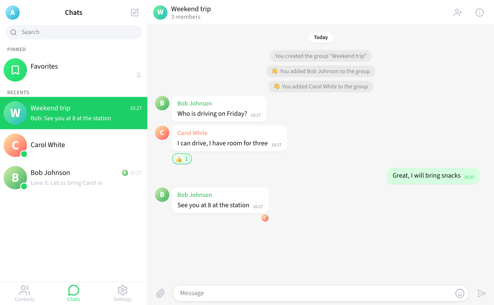
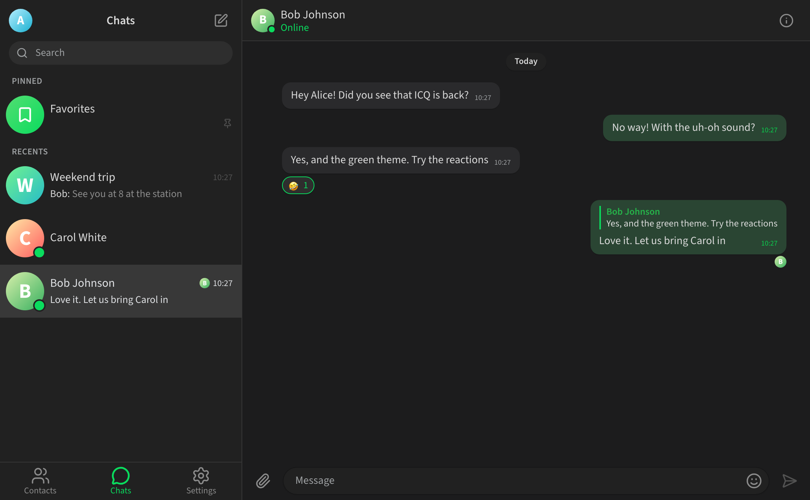
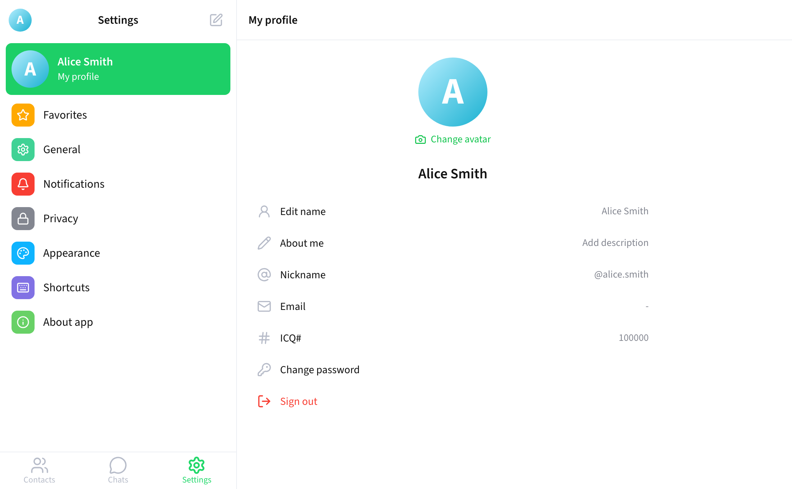
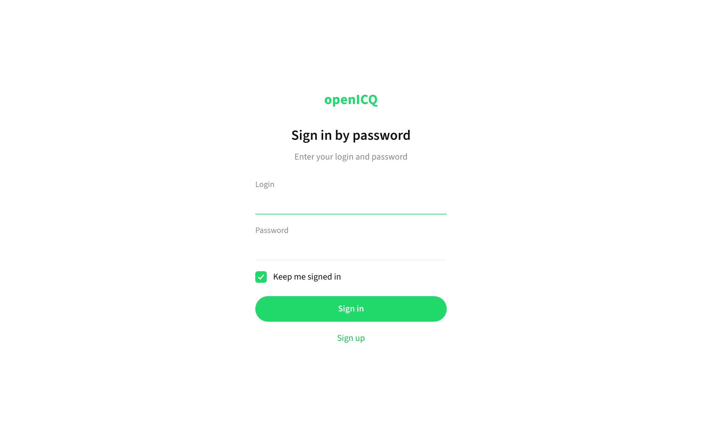
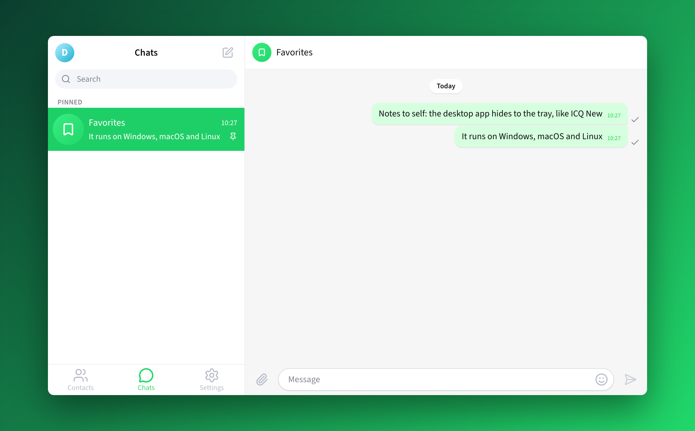
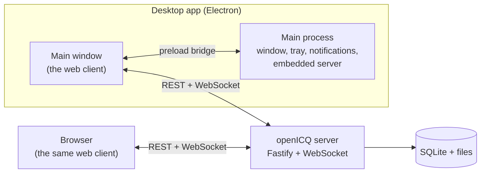

<p align="center">
  
</p>

<h1 align="center">openICQ</h1>

<p align="center">
  The last ICQ, ICQ New (2020 to 2024), rebuilt from scratch and open source.<br />
  A desktop app for Windows, macOS and Linux, and a web app for any browser, with your own server.
</p>

<p align="center">
  <a href="https://github.com/saharhazan/openICQ/releases/latest"><strong>Download</strong></a> ·
  <a href="#install">Install</a> ·
  <a href="#run-a-server">Run a server</a> ·
  <a href="#develop">Develop</a> ·
  <a href="README.he.md">עברית</a>
</p>

<p align="center">
  <a href="https://github.com/saharhazan/openICQ/actions/workflows/ci.yml"></a>
  <a href="https://github.com/saharhazan/openICQ/releases/latest"></a>
  <a href="LICENSE"></a>
</p>


ICQ shut down on 26 June 2024. Its last version, ICQ New 23.2.0, was a modern messenger: a chat list next to the conversation, green bubbles, groups, reactions, and the "uh-oh" sound. openICQ brings it back as something you own. You run the server, on your computer, at home or on a VPS, and everyone you invite gets their own ICQ number.

It is not a mockup. A real server stores accounts, chats, groups, files and history, and every client talks to it in real time.

## Features

- **Your ICQ number**: sign up with a name and a password, and get a sequential ICQ# (from 100000). Sign in with the ICQ# or your email. "Keep me signed in".
- **Chats**:
  - The chat list has Favorites pinned on top, pinning, unread counters, mute, "Mark as unread", "Clear history", drafts, and "is typing...".
  - Search covers your chats, your contacts and people on the server.
- **Messages**:
  - Bubbles with the original metrics, date pills, "New messages", and delivery ticks with read avatars.
  - Reply, forward, edit ("edited"), delete for me or for everyone.
  - The six ICQ New reactions, an emoji picker, multi-select.
- **Files and images**: attach, drag and drop (Quick send or with a caption), paste, image previews and a viewer.
- **Groups**:
  - Creator, Admin, member and Read only roles; adding members; invite links (copy, generate new).
  - Join with approval, and the original service messages.
- **Contacts and profiles**:
  - Add by nickname or ICQ#. Profile with avatar, name, "About me" and a nickname (checked live).
  - Blocking.
- **Settings**:
  - General, Notifications (sounds, desktop notifications, hide text or sender), and Privacy ("Who can add me to groups", Session List).
  - Appearance (Green and Dark Green themes, font size, compact chat list), Shortcuts (send by Enter, Ctrl+Enter or Shift+Enter).
- **Several devices**: sign in on many devices at once; close any session from Session List.
- **Desktop app**:
  - One main window (1000 x 600, as in ICQ New) that hides to the tray on close, with an unread badge and native notifications.
  - "Launch when system starts", and a server built in.

| | |
|---|---|
|  |  |
|  |  |



## Install

Download the file for your system from the [latest release](https://github.com/saharhazan/openICQ/releases/latest):

| System | File |
|---|---|
| Windows 10 and 11 | the `.exe` setup |
| macOS, Apple Silicon | `openICQ-<version>-mac-arm64.dmg` |
| macOS, Intel | `openICQ-<version>-mac-x64.dmg` |
| Linux | the `.AppImage` (any distribution) or the `.deb` (Debian, Ubuntu); x64 and arm64 |

The builds are not signed with a paid certificate, so each system asks once before the first start:

- **macOS**: open the dmg and drag openICQ to Applications. Right-click openICQ, choose **Open**, then **Open** again. If macOS reports that the app "is damaged", run `xattr -dr com.apple.quarantine /Applications/openICQ.app` once.
- **Windows**: SmartScreen may say "Windows protected your PC". Click **More info**, then **Run anyway**.
- **Linux**: `chmod +x openICQ-*.AppImage && ./openICQ-*.AppImage`, or `sudo apt install ./openICQ-*.deb`. If the AppImage closes right away on Ubuntu 24.04 or later, install the `.deb` instead. Ubuntu restricts the sandbox that AppImages use. For the tray icon on GNOME, install the "AppIndicator and KStatusNotifierItem Support" extension.

`SHA256SUMS.txt` in every release lists the checksum of each file.

### First start

openICQ asks how to connect:

- **Host a server on this computer**: the app runs the openICQ server itself, and your chats are stored on this computer. Tick **Let other computers on my network connect** and the dialog shows the address your friends type in.
- **Connect to a server**: enter the address of an openICQ server, for example a friend's computer (`192.168.1.20:5190`) or a server on the internet (`chat.example.com`, which uses HTTPS).

You can change this later from the tray menu (**Connection Settings...**) or in Settings, General. Then sign up, add your friends by nickname or ICQ#, and start chatting.

## Run a server

For a server that is always on (a home server, a NAS, a VPS):

```sh
docker compose -f docker/compose.yaml up -d
```

Then open `http://localhost:5190`, or point the desktop app at this machine. Everything is stored in the `openicq-data` volume. Before you put the server on the internet:

- List every address people use in `ALLOWED_ORIGINS` (for example `https://chat.example.com`).
- Serve it over HTTPS, for example behind Caddy or nginx, and set `COOKIE_SECURE=true`.
- Check the storage limits: `MAX_FILE_BYTES` (one file, default 100 MB), `MAX_USER_STORAGE_BYTES` (per user, default 2 GB) and `MAX_TOTAL_STORAGE_BYTES` (all files, default unlimited).

Without Docker, with Node.js 26 and pnpm 10:

```sh
pnpm install
pnpm build
pnpm start        # http://127.0.0.1:5190
```

All settings come from environment variables; see [`apps/server/.env.example`](apps/server/.env.example).

## Develop

```sh
pnpm install
pnpm dev            # server on :5190 and the web client with hot reload on http://127.0.0.1:5173
pnpm dev:desktop    # builds and starts the desktop app
pnpm dist:desktop   # installers for the current OS into apps/desktop/release
```

| Check | Command |
|---|---|
| Lint and types | `pnpm lint`, `pnpm typecheck` |
| Unit and integration tests | `pnpm test` |
| Web end-to-end, two users in Chromium | `pnpm test:e2e` |
| Desktop end-to-end, two Electron apps | `pnpm test:desktop` |
| README screenshots | `pnpm --filter @openicq/e2e screenshots` |

GitHub Actions runs all of them, with the desktop tests on Windows, macOS and Linux. Pushing a `v*` tag builds the installers on each OS and publishes a release.

### Architecture



| Package | What it is |
|---|---|
| `packages/protocol` | The wire contract: zod schemas for every request, result and event, shared by client and server. |
| `apps/server` | Fastify 5 with WebSockets, SQLite (`node:sqlite`) and file storage. Layers: domain, application, infrastructure, transport. Each event payload is built for its recipient (unread counts, "mine" reactions). |
| `apps/client` | React 19 + zustand. The ICQ New design: theme tokens as CSS variables, Source Sans 3, a pure event reducer, optimistic sending. |
| `packages/desktop-bridge` | The contract between the desktop shell and the client (notifications, unread badge, window state), validated on both sides. |
| `apps/desktop` | Electron 44: the main window, tray, notifications, and the embedded server for "Host a server". |
| `tests/e2e` | Playwright: two users in the browser, two desktop apps, and the screenshot generator. |

## How faithful is it?

The design and the behaviour come from the original. Our sources:

- The official ICQ desktop client source ([mail-ru-im/im-desktop](https://github.com/mail-ru-im/im-desktop), Apache 2.0).
- The final ICQ New 23.2.0 installers, examined with [REA](https://github.com/morluto/rea) without running them.
- Archived help pages.

From these come the exact theme colours, sizes, layout, menus in their original order, strings, sounds and behaviours. The findings are in [`docs/research`](docs/research). An earlier rebuild of ICQ 2001b is kept under the git tag `classic-2001b`.

What differs, on purpose:

- **Sign-in**: ICQ# or email and a password; there is no phone number and no SMS code.
- **Calls**: voice and video calls are planned for a later version.
- **Not in this version**: channels, voice messages, link previews and mentions.
- **Artwork**: icons come from [Lucide](https://lucide.dev) (ISC) and emoji from your system. The original icons, stickers, emoji images, fonts and sounds are not used; the sounds are synthesized. The app icon is our own flower.
- **Unknown details**: where the sources did not reveal something (edit time limits, file size limits), the choice is documented in the research notes and the architecture plan.

## Security

- **Accounts and sessions**:
  - Passwords are hashed with scrypt. Sessions are random tokens stored only as SHA-256, in an HttpOnly, SameSite=Strict cookie.
  - Every request and event is validated with zod at the boundary. Every chat, message, group and file action is checked against the user's membership and role.
- **Files**:
  - Images are recognized by their content.
  - Downloads are served with `nosniff`, a sandboxing CSP and `attachment` for anything that is not an image.
  - Storage quotas apply, and unattached uploads are cleaned up.
- **Web**: a strict Content Security Policy and an origin allowlist. Messages, edits, reactions, uploads, logins, registrations and password changes are rate-limited.
- **Desktop app**:
  - Sandboxed renderer with context isolation and no Node in the page. Navigation stays on your server, and the main process validates every IPC message again.
  - Electron fuses are set: no `RunAsNode`, no `NODE_OPTIONS`, no `--inspect`, and asar integrity is checked.

Found a problem? Please open an issue, or a private security advisory for anything sensitive.

## Legal

openICQ is an independent fan project. It is not affiliated with, endorsed by or connected to ICQ, AOL, Mail.ru or VK. "ICQ" and its logos are trademarks of their respective owners and are used here only to describe what this project recreates.

The code is released under the [MIT License](LICENSE). It uses design values, strings and behaviour from the Apache 2.0 licensed ICQ desktop client, Source Sans 3 (SIL OFL 1.1), Lucide icons (ISC) and emojibase data (MIT); see [third-party notices](docs/licenses/THIRD_PARTY.md).
